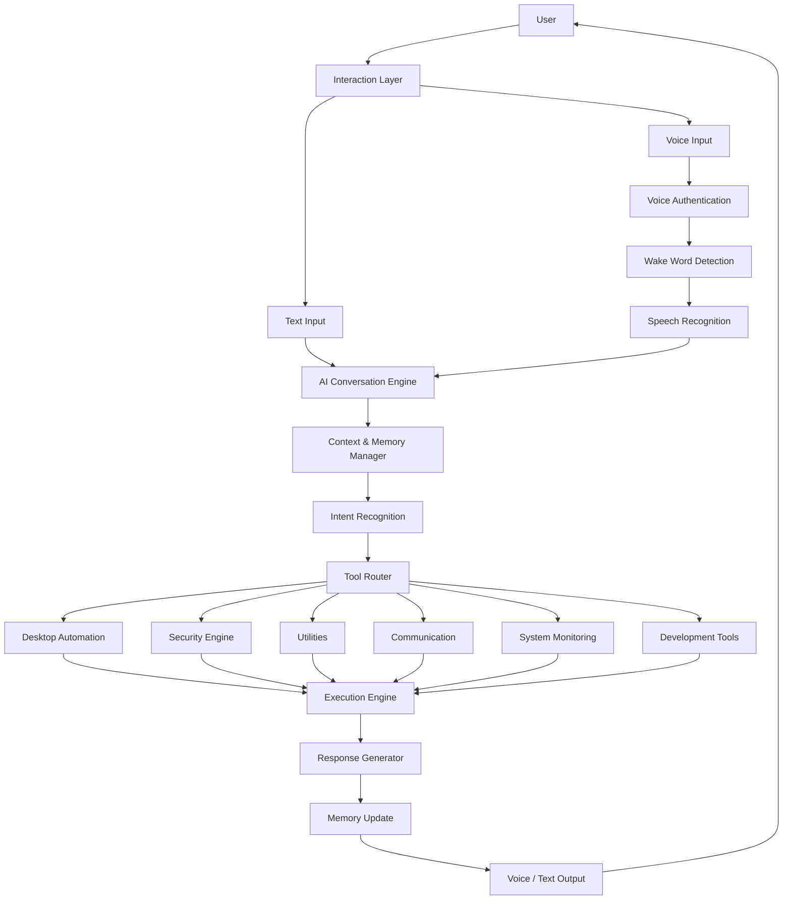
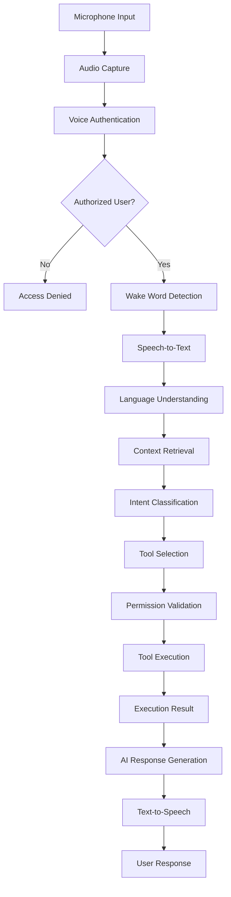
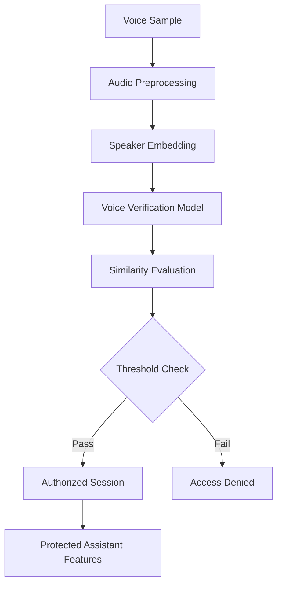
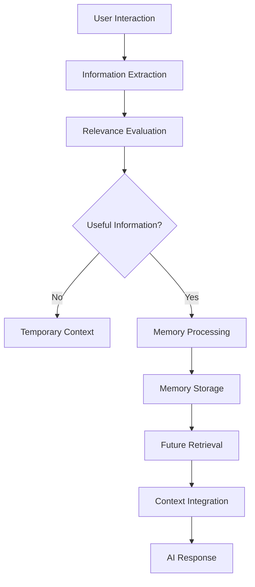
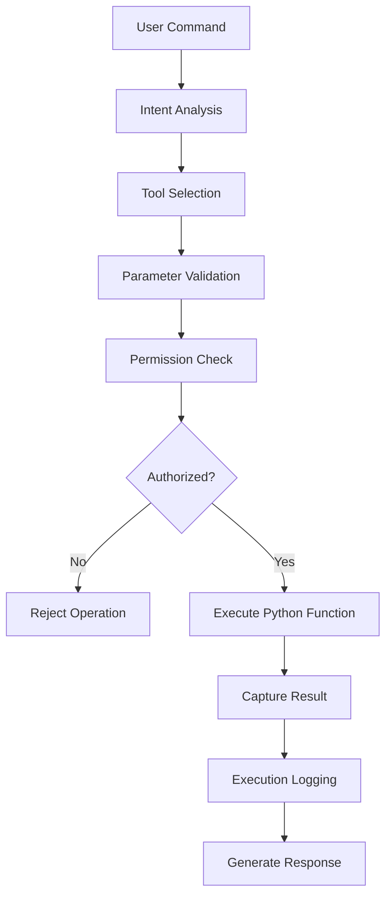
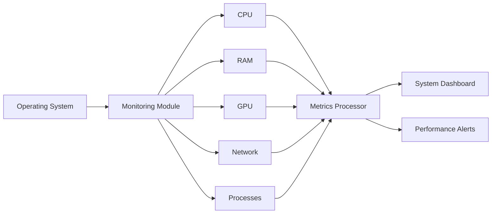

<div align="center">

# HEART AI
### HUMAN-CENTRIC • EVOLVING • AUTONOMOUS • RESPONSIVE TECHNOLOGY

**An Intelligent Personal AI Assistant for Desktop Automation, Voice Intelligence & Human-AI Interaction.**


<br/>

[](https://www.python.org/)
[](https://openrouter.ai/)
[](https://livekit.io/)
[](https://www.microsoft.com/windows)
[]()

<br/>

**Designed & Engineered by [D3V1L96](https://github.com/NEURAL96)**

</div>

---

# 01. Overview

**HEART AI** is a modular, Python-based personal artificial intelligence assistant designed to transform traditional desktop interaction into an intelligent, voice-driven computing experience.

Unlike conventional chatbots, HEART combines conversational intelligence, voice biometric authentication, persistent memory, desktop automation, system monitoring, and intelligent tool execution within a unified architecture.

HEART is designed to understand natural language, interpret user intentions, select appropriate tools, execute authorized operations, and deliver contextual responses.

It acts as an intelligent desktop companion capable of assisting with productivity, system management, development workflows, communication, and everyday computing operations.

### Core Philosophy

> Intelligence is not just about answering questions. It is about understanding intent, remembering context, making decisions, and executing actions responsibly.

### Project Objectives

- Build a natural human-computer interaction system.
- Integrate real-time conversational AI with desktop operations.
- Implement secure voice-based user authentication.
- Develop contextual and persistent memory.
- Automate repetitive desktop operations.
- Monitor system performance and resource utilization.
- Create an extensible architecture for future AI capabilities.

---

# 02. System Capabilities

<table>
<tr>
<td width="50%">

### AI Intelligence
- Natural language understanding
- Context-aware conversations
- Intelligent intent recognition
- Function and tool calling
- Personality-driven responses
- AI-powered coding assistance

</td>
<td width="50%">

### Voice Intelligence
- Real-time voice interaction
- Wake-word activation
- Speech-to-text processing
- Text-to-speech responses
- Voice biometric authentication
- Speaker verification

</td>
</tr>
<tr>
<td>

### Desktop Automation
- Application management
- Mouse and keyboard control
- File and folder operations
- Software installation and removal
- Browser automation
- Windows system operations

</td>
<td>

### Memory Intelligence
- Persistent conversation memory
- Context retrieval
- User preference management
- Relevant information storage
- Conversation continuity
- Selective memory management

</td>
</tr>
<tr>
<td>

### Productivity Engine
- Python code generation
- PowerPoint generation
- PDF processing
- Email draft generation
- Web search
- Weather and utility services

</td>
<td>

### Security & Monitoring
- Voice authentication
- CPU and RAM monitoring
- GPU monitoring
- Network usage analysis
- Process monitoring
- Privacy and security reporting

</td>
</tr>
<tr>
<td>

### Communication
- WhatsApp Desktop automation
- Message composition
- File sharing workflows
- Incoming message monitoring
- Emergency location-sharing workflows

</td>
<td>

### Intelligent Utilities
- Application launcher
- System information
- File search
- Browser assistance
- Development assistance
- Custom automation tools

</td>
</tr>
</table>

---

# 03. System Architecture

HEART follows a modular, tool-oriented architecture in which individual components operate independently while communicating through a central intelligence layer.



### Architecture Layers

| Layer | Responsibility |
|---|---|
| Interaction Layer | Accepts voice and text input |
| Authentication Layer | Verifies authorized users |
| Intelligence Layer | Processes natural language |
| Context Layer | Retrieves relevant memory |
| Intent Layer | Determines user objectives |
| Tool Router | Selects the appropriate function |
| Execution Layer | Performs authorized operations |
| Response Layer | Generates contextual responses |
| Memory Layer | Updates relevant conversation data |

---

# 04. Voice Processing Workflow

HEART uses a voice-oriented processing pipeline to transform spoken commands into executable operations.



### Voice Pipeline Components

- Audio capture and preprocessing.
- Voice biometric verification.
- Wake-word detection.
- Speech recognition.
- Natural language interpretation.
- Context retrieval.
- Tool execution.
- Speech response generation.

**Security principle:** Voice authentication should be treated as one security signal, not an infallible identity mechanism. Sensitive operations should use additional authorization controls.

---

# 05. AI Intelligence Engine

The AI Conversation Engine is the central intelligence component of HEART.

It connects conversational models with memory, intent recognition, and external tools.

### AI Capabilities

| Capability | Description |
|---|---|
| Natural Language Processing | Understands conversational instructions |
| Context Awareness | Uses relevant conversation history |
| Function Calling | Selects appropriate Python tools |
| Response Generation | Produces natural language responses |
| Memory Integration | Retrieves relevant stored information |
| Personality Engine | Maintains consistent assistant behavior |

### AI Integration Stack

| Technology | Purpose |
|---|---|
| Google Gemini Realtime | Real-time conversational AI |
| OpenRouter | Model access and routing |
| LiveKit Agents | Real-time voice agent infrastructure |
| Python | Core application logic |
| Pydantic | Data validation and structured models |

The architecture supports extensibility for additional AI models and locally hosted inference engines.

---

# 06. Voice Authentication & Security

HEART integrates voice-based biometric authentication to support controlled access to assistant functionality.

### Authentication Workflow



### Security Components

- Speaker embedding generation.
- Voice similarity evaluation.
- Authentication threshold.
- Session authorization.
- Unauthorized-access rejection.
- Protected tool execution.

### Security Architecture Principles

HEART follows a security-first design philosophy:

1. Safety before functionality.
2. Security before convenience.
3. Privacy before external integration.
4. Explicit permission for sensitive operations.
5. Minimal collection of user information.
6. Controlled access to system resources.

**Important:** Voice verification does not independently prevent replay attacks, synthetic voice attacks, or unauthorized access. Production deployments should consider liveness detection, secure session management, and additional authentication factors.

---

# 07. Memory Management System

HEART incorporates persistent memory to maintain continuity across conversations.

Instead of treating every interaction as an isolated request, the memory subsystem provides relevant contextual information to the AI engine.

### Memory Lifecycle



### Memory Features

- Conversation continuity.
- Selective information retention.
- Context retrieval.
- User preference handling.
- Relevant historical information.
- Memory-aware response generation.

### Memory Design Goals

- Avoid unnecessary conversation-history loading.
- Keep memory retrieval efficient.
- Prevent irrelevant context injection.
- Maintain privacy and user control.
- Support future semantic retrieval capabilities.

---

# 08. Desktop Automation Engine

The automation engine connects AI-generated intentions with real operating-system operations.

It enables HEART to interact with the Windows desktop through Python-based automation interfaces.

### Automation Capabilities

| Category | Operations |
|---|---|
| Application Control | Open, close and manage applications |
| File Management | Create, move, rename and organize files |
| Keyboard Automation | Simulate keyboard interactions |
| Mouse Automation | Perform mouse operations |
| Browser Automation | Control supported browser workflows |
| Software Management | Install and uninstall supported software |
| System Control | Execute selected Windows operations |

### Execution Workflow



### Automation Safety

HEART should implement:

- Allowlisted commands.
- Input validation.
- Restricted execution permissions.
- Confirmation for destructive operations.
- Safe subprocess execution.
- Execution logging.
- Timeouts and error handling.

---

# 09. System Monitoring & Diagnostics

HEART includes system monitoring capabilities to provide information about the computer's operational state.

### Monitoring Components

| Metric | Technology |
|---|---|
| CPU Utilization | psutil |
| RAM Utilization | psutil |
| Running Processes | psutil |
| Network Statistics | psutil |
| GPU Monitoring | NVIDIA NVML |
| GPU Utilization | NVIDIA Management Library |
| GPU Memory | NVIDIA Management Library |

### Monitoring Workflow



---

# 10. Productivity & Communication Modules

HEART integrates multiple productivity tools into one assistant environment.

### Development Assistance

- AI-assisted Python code generation.
- Programming guidance.
- Debugging assistance.
- Development workflow support.

### Document Processing

- PDF reading and processing.
- PowerPoint presentation generation.
- Document automation.
- File organization.

### Communication

- WhatsApp Desktop interaction.
- Message composition.
- File-sharing automation.
- Incoming-message monitoring.
- Email draft generation.

### External Services

- Web search integration.
- Weather information.
- Time and utility services.
- External API integrations.

All external integrations depend on their respective API availability, authentication, and service policies.

---

# 11. Technology Stack

HEART uses a combination of Python libraries, AI services, desktop automation frameworks, and system-level interfaces.

| Domain | Technology | Purpose |
|---|---|---|
| Core Language | Python | Application development |
| AI Models | Google Gemini | Conversational intelligence |
| AI Routing | OpenRouter | Model access |
| Realtime Communication | LiveKit | Voice agent infrastructure |
| Data Validation | Pydantic | Structured data validation |
| Machine Learning | PyTorch | ML model support |
| Computer Vision | OpenCV | Image and camera processing |
| System Monitoring | psutil | OS monitoring |
| GPU Monitoring | NVIDIA NVML | GPU statistics |
| Desktop Automation | PyAutoGUI | Mouse and keyboard control |
| Browser Automation | Selenium | Browser interaction |
| Windows Integration | Win32 API | Windows system operations |
| Speech Recognition | Vosk | Offline speech recognition |
| Web Search | SerpAPI | Search integration |
| Weather | OpenWeather API | Weather information |
| Cryptography | Cryptography | Encryption utilities |

*The table represents the project's technology ecosystem. Exact module usage and dependency versions should be verified against the current implementation.*

---

# 12. Project Structure

The following represents the intended modular organization of HEART. Adapt filenames to match the actual repository.

```text
HEART-AI/
│
├── heart.py
├── bootloader.py
├── heart_bridge.py
│
├── core/
│   ├── neural_schema.py
│   ├── conversation_engine.py
│   ├── intent_recognition.py
│   ├── policy_engine.py
│   └── tool_router.py
│
├── voice/
│   ├── voice_authentication.py
│   ├── wake_word.py
│   ├── speech_recognition.py
│   ├── speech_synthesis.py
│   └── audio_processing.py
│
├── memory/
│   ├── heart_memory.py
│   ├── memory_manager.py
│   ├── context_retrieval.py
│   └── memory_storage.py
│
├── automation/
│   ├── application_control.py
│   ├── file_manager.py
│   ├── browser_automation.py
│   ├── keyboard_control.py
│   └── system_control.py
│
├── security/
│   ├── authentication.py
│   ├── permission_manager.py
│   ├── policy_engine.py
│   └── audit_logger.py
│
├── monitoring/
│   ├── cpu_monitor.py
│   ├── memory_monitor.py
│   ├── gpu_monitor.py
│   └── network_monitor.py
│
├── integrations/
│   ├── google_ai.py
│   ├── openrouter.py
│   ├── whatsapp.py
│   ├── email.py
│   ├── weather.py
│   └── web_search.py
│
├── productivity/
│   ├── code_generator.py
│   ├── pdf_processor.py
│   ├── presentation_generator.py
│   └── document_manager.py
│
├── interface/
│   ├── heart_hud.py
│   └── heart_hud_server.py
│
├── assets/
│   ├── images/
│   ├── icons/
│   └── audio/
│
├── tests/
│   ├── test_memory.py
│   ├── test_voice.py
│   ├── test_automation.py
│   └── test_security.py
│
├── requirements.txt
├── .env.example
├── .gitignore
├── LICENSE
└── README.md
```

---

# 13. Third-Party License Compliance

HEART integrates open-source software and external AI services. Each dependency retains its own licensing requirements.

The following table identifies the expected upstream license families. Exact versions and bundled components must be checked before distribution.

| Technology | License / Terms | Category |
|---|---|---|
| Python | PSF License | Open Source |
| LiveKit | Apache 2.0 | Open Source |
| PyTorch | BSD-style | Open Source |
| OpenCV | Apache 2.0 | Open Source |
| psutil | BSD 3-Clause | Open Source |
| Selenium | Apache 2.0 | Open Source |
| PyAutoGUI | BSD 3-Clause | Open Source |
| Pydantic | MIT | Open Source |
| Vosk | Apache 2.0 | Open Source |
| Cryptography | Apache 2.0 / BSD 3-Clause | Open Source |
| NumPy | BSD 3-Clause | Open Source |
| Google Gemini | Google API / Service Terms | Commercial Service |
| OpenRouter | OpenRouter Service Terms | Commercial Service |
| SerpAPI | SerpAPI Service Terms | Commercial Service |
| OpenWeather | OpenWeather API Terms | Commercial Service |
| NVIDIA NVML | NVIDIA SDK / Software Terms | Proprietary Components |

### License Compliance Guidelines

- Preserve original copyright notices.
- Include required license and attribution files.
- Review Apache 2.0 NOTICE requirements.
- Review BSD redistribution conditions.
- Follow MIT license attribution requirements.
- Review commercial API terms separately.
- Verify individual model-weight licenses.
- Review third-party assets, fonts, icons and datasets.
- Maintain a dependency license inventory.

### Important Licensing Note

The HEART repository license does not automatically override the licenses of third-party dependencies, AI models, datasets, or external services.

A complete software distribution should include a verified dependency lockfile and third-party notices.

---

# 14. Installation & Configuration

### Requirements

- Windows 10/11
- Python 3.x compatible with project dependencies
- Internet connection for cloud AI integrations
- Microphone for voice interaction
- Optional NVIDIA GPU for supported acceleration

### Clone Repository

```bash
git clone https://github.com/D3V1L96/HEART-AI.git

cd HEART-AI
```

### Create Virtual Environment

```bash
python -m venv .venv
```

### Activate Environment

```powershell
.venv\Scripts\activate
```

### Install Dependencies

```bash
pip install -r requirements.txt
```

### Configure Environment

Create a `.env` file using `.env.example`.

```env
GOOGLE_API_KEY=
OPENROUTER_API_KEY=
SERPAPI_API_KEY=
OPENWEATHER_API_KEY=
```

Use only the variables required by the actual integrations. Never commit API keys or authentication credentials.

### Launch HEART

```bash
python bootloader.py
```

*Installation commands and configuration variables should be adjusted to match the current repository implementation.*

---

# 15. Privacy & Security Philosophy

HEART is designed around a privacy-conscious and security-first architecture.

### Design Principles

**Privacy**
- Minimize unnecessary external data transmission.
- Protect sensitive configuration.
- Keep authentication data access-controlled.

**Security**
- Validate tool inputs.
- Restrict sensitive system operations.
- Use controlled execution permissions.
- Maintain execution logs.

**Reliability**
- Modular components.
- Exception handling.
- Controlled service initialization.
- Graceful failure handling.

**Transparency**
- Clear operation results.
- Explainable tool execution.
- Explicit authorization for sensitive actions.

---

# 16. Future Roadmap

| Feature | Status |
|---|---|
| AI Conversation Engine | Core Development |
| Voice Authentication | Development |
| Wake Word Detection | Development |
| Persistent Memory | Development |
| Desktop Automation | Development |
| System Monitoring | Development |
| WhatsApp Integration | Development |
| AI Code Assistance | Planned |
| Local LLM Integration | Planned |
| Advanced Vision Intelligence | Planned |
| Plugin Architecture | Planned |
| Smart Scheduling | Planned |
| Knowledge Base / RAG | Planned |
| Cross-Platform Support | Planned |
| Mobile Companion | Planned |

---

# 17. Engineering Vision

HEART is an evolving exploration of intelligent desktop computing.

The long-term vision is to develop an assistant that combines:

- Human-like conversational interaction.
- Secure voice-based access.
- Context-aware intelligence.
- Adaptive memory management.
- Autonomous but permission-controlled automation.
- Real-time system awareness.
- Modular AI integrations.

The objective is not simply to create another chatbot.

It is to build a unified intelligence layer between the user and the operating system.

---

# 18. Author

<div align="center">

## TILAK KUMAR
### D3V1L96 | AI & CYBERSECURITY ENGINEERING

Python Developer • AI Enthusiast • Cybersecurity Engineer

Building intelligent systems at the intersection of AI, automation, and security.

[](https://github.com/D3V1L96)

</div>

---

# 19. License

The HEART AI source code is distributed under the license specified in the repository's `LICENSE` file.

Third-party dependencies, AI models, APIs, and external services remain subject to their respective licenses and terms.

---

<div align="center">


### HEART AI
**Intelligence. Security. Automation.**

*Engineered with purpose. Designed to evolve.*

**© 2026 D3V1L96**

</div>
